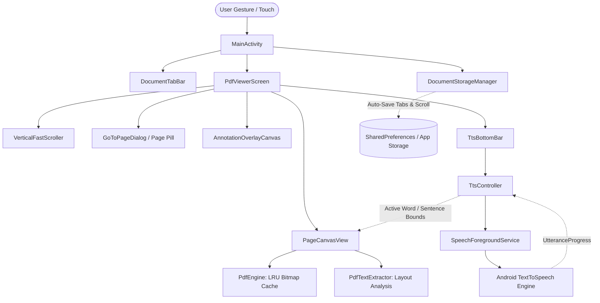

# Xouryn PDF Reader

[-brightgreen.svg)](https://developer.android.com)
[](https://kotlinlang.org)
[](https://developer.android.com/jetpack/compose)
[]()

A modern, high-performance, open-source Android PDF workspace and reader engineered for **smartphones, foldables, and tablets**. **Xouryn PDF Reader** combines the natural prosody and background audio capabilities of **ReadEra** with the professional stylus, navigation, and continuous-scrolling document experience of **Xodo**.

---

## Table of Contents
1. [Key Features](#-key-features)
2. [Installation Guide (For Users & Testers)](#-installation-guide-for-users--testers)
3. [Developer Setup & Environment](#-developer-setup--environment)
4. [Building from Source](#-building-from-source)
5. [Testing & Debugging on Devices](#-testing--debugging-on-devices)
6. [Codebase Architecture & Internal Design](#-codebase-architecture--internal-design)
7. [Memory & Performance Guidelines](#-memory--performance-guidelines)
8. [Roadmap & Contributing](#-roadmap--contributing)
9. [License](#-license)

---

## 🌟 Key Features

### 1. ReadEra-Grade "Read Out Loud" (TTS) Suite
- **Interactive Tap-to-Speak:** Tap anywhere on a page or highlight a paragraph to start natural text-to-speech reading immediately from that point.
- **Synchronized Visual Highlighting:** Real-time utterance tracking highlights spoken sentences and words with a warm, glowing pulse.
- **Adaptive Prosody & Line Clustering:** Intelligently groups multi-column text, fixes line-break hyphenations, and filters uneven/scanned line layouts (such as non-straight book scans) to deliver smooth, human-like voice reading without stuttering.
- **Granular Speech Settings:**
  - Speed adjustment from **0.5x to 3.0x** (with a quick-toggle speed pill: `0.75x`, `1.0x`, `1.25x`, `1.5x`, `2.0x`).
  - Voice pitch modulation (**0.5x to 2.0x**).
  - Sleep timer (**15, 30, 45, 60 minutes**).
  - Global voice dialect picker (US, UK, Indian, Australian, Canadian, and multilingual system voices).
- **Background Playback & Lock-Screen Controls:** Powered by `SpeechForegroundService` with `FOREGROUND_SERVICE_MEDIA_PLAYBACK`. Continue listening with your screen locked or while using other apps, complete with media notification and Bluetooth headset support.

### 2. Smooth Continuous Viewer & Xodo Navigation
- **Infinite Long Document Support:** Memory-optimized rendering pipeline handles 600+ page books with rock-solid memory recycling and zero lag.
- **Full-Screen Immersive Mode:** Tap once anywhere on the page to hide all toolbars, tabs, and system status/navigation bars. Tap again to restore them. Works seamlessly even while Read Out Loud is speaking.
- **Xodo-Style Quick Jump Pill:** Floating top-left badge (e.g. `268 / 670`) shows current progress. Tapping it opens an interactive "Go to Page" jump dialog.
- **Vertical Fast-Scroller:** Draggable side rail with a tactile `:::` grip handle to rapidly skim across hundreds of pages in seconds.
- **Smart Persistent Memory:** Automatically remembers and restores all opened document tabs, active tab selection, and exact scroll positions across app restarts.

### 3. Professional Annotation & Stylus Suite
- **S-Pen & Active Stylus Awareness:** Rejects palm interference by distinguishing stylus pen inputs (`TOOL_TYPE_STYLUS`) from finger gestures (`TOOL_TYPE_FINGER`). Fingers pan and zoom while the stylus draws effortlessly.
- **Vector Bézier Smoothing:** Freehand ink captures sub-pixel touch coordinates and renders smooth quadratic Bézier curves.
- **Text Markup Tools:** Highlighter with `BlendMode.Multiply` (retains 100% underlying text legibility), Underline, and Strikeout.
- **Shapes & Signature Stamp:** Insert Rectangles, Ovals, Arrows, and custom vector signatures with full multi-level Undo/Redo support.

---

## 📲 Installation Guide (For Users & Testers)

### Option 1: Direct APK Installation (Fastest)
The compiled standalone APK is generated directly in the repository root:
- **`Xouryn-PDF-Reader.apk`** (or `xouryn-pdf-reader.apk`)

#### Steps to Install on Your Android Device:
1. **Transfer the APK to your device:**
   - Send via USB cable, Google Drive, WhatsApp, Telegram, or AirDrop/LocalSend.
2. **Enable Unknown App Installation:**
   - On Android: Go to **Settings > Apps > Special app access > Install unknown apps**.
   - Select your file manager or browser and toggle **Allow from this source** to ON.
3. **Open and Install:**
   - Tap `Xouryn-PDF-Reader.apk` in your device's Files/Downloads app.
   - Tap **Install**. (If Google Play Protect displays an "Unrecognized app" prompt for debug builds, tap **More details > Install anyway**).
4. **Launch:**
   - Look for **Xouryn PDF Reader** with its custom logo in your app drawer or home screen!

---

## 🛠️ Developer Setup & Environment

For contributors and developers who want to work on this codebase:

### System Prerequisites
- **Operating System:** macOS (Apple Silicon or Intel), Linux (Ubuntu 22.04+), or Windows 11.
- **Java Development Kit (JDK):** **JDK 17** (Temurin / Adoptium or OpenJDK 17 recommended).
- **Android SDK:**
  - `compileSdk`: **35** (Android 15)
  - `minSdk`: **26** (Android 8.0 Oreo)
  - `targetSdk`: **35**
  - Android SDK Build-Tools: **35.0.0**
- **Recommended IDE:** **Android Studio Ladybug (2024.2+)** or **Android Studio Meerkat (2024.3+)**.

### Cloning the Repository
```bash
git clone https://github.com/sourin07/zt1.git
cd zt1
```

---

## 🚀 Building from Source

### Automated Local Build Script (Recommended)
The project includes a self-contained local build script that automatically checks JDK 17, initializes the SDK path, and produces the APK:
```bash
chmod +x build-apk-local.sh
./build-apk-local.sh
```
Upon completion, the build script places the output at `./Xouryn-PDF-Reader.apk`.

### Standard Gradle Build
If building via standard Gradle wrapper:
```bash
# On macOS / Linux:
./gradlew assembleDebug

# On Windows:
gradlew.bat assembleDebug
```
The output APK will be generated at:
`app/build/outputs/apk/debug/app-debug.apk`

---

## 📱 Testing & Debugging on Devices

### 1. Using Android Studio
1. Launch Android Studio.
2. Select **Open** and choose the `zt1` project root folder.
3. Allow Gradle to sync dependencies.
4. Select your connected physical phone or an Android Virtual Device (AVD).
5. Click the green **Run (▶)** button or press `Shift + F10`.

### 2. Command-Line ADB Deployment
Make sure USB Debugging is enabled on your phone (**Settings > Developer Options > USB Debugging**):
```bash
# Verify your device is recognized
adb devices

# Install and launch directly
adb install -r Xouryn-PDF-Reader.apk
adb shell am start -n com.novapdf.reader/.ui.MainActivity
```

### 3. Inspecting Logs
To view live logs from the PDF rendering engine and TTS service:
```bash
adb logcat -s "PdfEngine" "TtsController" "SpeechService" "XourynReader"
```

---

## 🏗️ Codebase Architecture & Internal Design

The source code is structured cleanly under `com.novapdf.reader`:

```
app/src/main/java/com/novapdf/reader/
├── engine/                       # Core PDF, Text & Annotation Engines
│   ├── PdfEngine.kt              # Thread-safe PdfRenderer wrapper with LRU Bitmap Cache
│   ├── PdfTextExtractor.kt       # Multi-column clustering, de-hyphenation & paragraph layout
│   ├── AnnotationEngine.kt       # In-memory vector annotation store with Undo/Redo stack
│   └── DocumentStorageManager.kt # Persistent JSON serialization of tabs & scroll state
├── model/                        # Immutable Data Models
│   ├── AnnotationModels.kt       # Sealed classes: Ink, Highlight, Underline, Shapes, Signature
│   ├── DocumentTab.kt            # Tab metadata, URI, title, page counts, active state
│   ├── PdfDocumentModel.kt       # High-level document state wrapper
│   ├── TextBounds.kt             # Bounding boxes for character, word, line & sentence highlights
│   └── TtsModels.kt              # Voice definitions, speech rates, pitch & playback state
├── tts/                          # Text-To-Speech & Background Playback
│   ├── SentenceTokenizer.kt      # Boundary analysis for natural sentence chunking
│   ├── SpeechForegroundService.kt# Foreground media service (MediaSession + lockscreen notification)
│   └── TtsController.kt          # Coordinator for Android TTS engine & sync callbacks
└── ui/                           # Jetpack Compose UI & Custom View Layers
    ├── MainActivity.kt           # Edge-to-edge root activity, SAF picker & window insets
    ├── annotations/              # Stylus toolbar, style pickers, signature dialog & overlay canvas
    ├── navigation/               # Thumbnails drawer, Outline tree & Bookmarks manager
    ├── tabs/                     # DocumentTabBar: multi-document browser-like tab strip
    ├── theme/                    # Material 3 colors, typography & reading themes
    ├── tts/                      # TtsBottomBar, speed/pitch dialog & voice selector sheet
    └── viewer/                   # Continuous scrolling viewer, fast-scroller, page pill & zoom
```

### How the Components Interact



---

## ⚡ Memory & Performance Guidelines

When developing features for Xouryn PDF Reader, adhere to the following architectural rules:

1. **Avoid Rendering Full-Resolution Bitmaps for Offscreen Pages:**
   - PDF pages are rendered on background threads (`Dispatchers.IO`).
   - Bitmaps are cached in an `LruCache` sized dynamically to a safe fraction of available device RAM.
   - When a page scrolls out of the visible viewport buffer, recycle or drop bitmap references to prevent `OutOfMemoryError` on 600+ page books.
2. **Keep the Main Thread Free of PDF Parsing:**
   - Text extraction (`PdfTextExtractor`) uses background coroutines.
   - Never execute file I/O or `PdfRenderer.Page.render` on `Dispatchers.Main`.
3. **Stylus Touch Isolation:**
   - All freehand drawing code must check `event.getToolType(0) == MotionEvent.TOOL_TYPE_STYLUS` to preserve palm rejection. Finger touches must remain reserved for smooth pinch-to-zoom and panning.
4. **TTS Natural Chunking:**
   - Never feed entire raw pages to the Android TTS engine in a single string. It causes robotic monotone pauses and ignores punctuation. Always route text through `SentenceTokenizer` and `PdfTextExtractor.clusterLines()`.

---

## 🗺️ Roadmap & Contributing

We welcome contributions! Here are areas where contributors can jump in:

### Good First Issues & Enhancements:
- [ ] **Table of Contents (Outline) Navigation:** Parse PDF outline bookmarks tree from document catalog and link to page jumps.
- [ ] **Dark & Sepia Reading Shaders:** Add color inversion and sepia matrix filters to `PageCanvasView` for low-light reading.
- [ ] **Export Annotated PDFs:** Flatten drawn vector annotations back into the exported PDF file using PDFBox.
- [ ] **Cloud Storage Sync:** Add native WebDAV, Google Drive, and Nextcloud document opening.
- [ ] **Custom Dictionary & Translation:** Add long-press word lookup and dictionary definitions sheet.

### Contributing Workflow:
1. **Fork the repository** and create a feature branch (`git checkout -b feature/amazing-feature`).
2. **Commit your changes** (`git commit -m 'Add amazing new feature'`).
3. **Verify the build passes** (`./build-apk-local.sh` or `./gradlew assembleDebug`).
4. **Push to your branch** (`git push origin feature/amazing-feature`).
5. **Open a Pull Request** with a description of your changes and screenshots/video if UI is modified.

---

## 📄 License

This project is licensed under the Apache 2.0 License. See the [LICENSE](LICENSE) file for details.
# Xouryn-PDF-Reader-Premium-PDF-Reader-with-Read-Out-Loud-Feature
